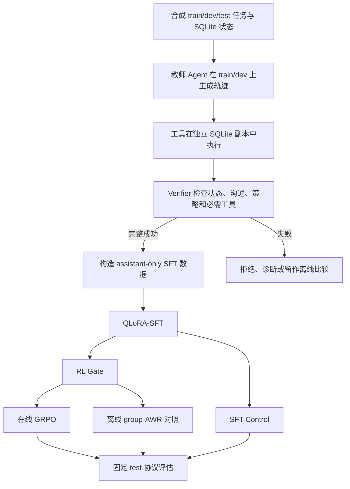
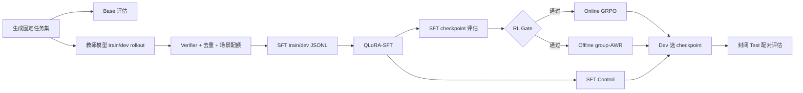

# 电商客服 Agent 项目：模型、框架、训练算法与 Verifier 完整说明

> 项目：`ecommerce-customer-service-agent-rl`  
> 整理日期：2026-09-28  
> 文档定位：汇总项目当前实现、设计动机、算法流程、方案比较、已知限制与实验状态。

## 目录

1. [一页结论](#一页结论)
2. [项目到底在解决什么问题](#项目到底在解决什么问题)
3. [项目当前到底用了什么](#项目当前到底用了什么)
4. [模型选择](#模型选择)
5. [Agent 与 Agent 框架](#agent-与-agent-框架)
6. [为什么当前不是 LangGraph 多 Agent 协同](#为什么当前不是-langgraph-多-agent-协同)
7. [任务、数据与训练轨迹从哪里来](#任务数据与训练轨迹从哪里来)
8. [Verifier：它不是训练出来的奖励模型](#verifier它不是训练出来的奖励模型)
9. [Verifier 应该如何选择](#verifier-应该如何选择)
10. [完整训练流程](#完整训练流程)
11. [QLoRA-SFT](#qlora-sft)
12. [验证器筛选 SFT 与 RSFT](#验证器筛选-sft-与-rsft)
13. [RL Gate](#rl-gate)
14. [在线 GRPO](#在线-grpo)
15. [严格奖励与塑形奖励](#严格奖励与塑形奖励)
16. [离线 group-AWR](#离线-group-awr)
17. [未实现算法及其流程](#未实现算法及其流程)
18. [为什么选择当前组合](#为什么选择当前组合)
19. [算法横向比较](#算法横向比较)
20. [评估方案](#评估方案)
21. [当前实验状态与不能声称的结论](#当前实验状态与不能声称的结论)
22. [主要风险与改进建议](#主要风险与改进建议)
23. [常见问题速查](#常见问题速查)
24. [代码与资料索引](#代码与资料索引)

---

## 一页结论

这个项目训练的不是一个单独存在的“Agent 程序”，而是 Agent 内部负责决策的语言模型。Agent 的工具、运行时、SQLite 环境和 Verifier 保持固定，主要更新模型的 LoRA 参数。

正式实验设计使用：

- 基础模型：`Qwen/Qwen2.5-7B-Instruct`；
- 监督阶段：验证器筛选成功轨迹后进行 QLoRA-SFT；
- 强化阶段：使用 TRL `GRPOTrainer` 进行在线、多轮、带真实工具环境的 GRPO；
- 主奖励：严格二元业务奖励；
- 消融奖励：策略违规硬归零的审计型塑形奖励；
- 离线对照：group-AWR 风格的组相对优势加权回归；
- Agent 运行时：默认是项目自写的原生循环，LangGraph 是可选运行时；
- Agent 架构：当前是单 Agent 工具调用工作流，不是多 Agent 系统；
- Verifier：确定性程序，不是训练出来的奖励模型；
- 当前状态：正式 7B 多随机种子实验仍标记为 `planned_gpu_runs`，不能宣称 GRPO 已被实验证明优于其他方案。

核心训练链路：



一句话概括各组件的分工：

```text
SFT：教会模型怎么调用工具和遵守基本流程
GRPO：提高当前模型真正完成任务的概率
Offline group-AWR：判断在线采样是否带来额外价值
Verifier：给出可审计的成功判定与奖励
QLoRA：让 7B 多阶段训练在有限显存下可执行
LangGraph：可选地把 Agent 状态和控制流显式化
```

---

## 项目到底在解决什么问题

项目目标不是让客服模型只生成一段“看起来专业”的回答，而是让它在真实状态环境中完成业务操作：

- 核验身份；
- 查询订单和物流；
- 判断取消、退款、改地址是否允许；
- 获取必要的用户确认；
- 调用写工具改变业务状态；
- 处理暂时性或持续性工具失败；
- 最终回复必须与数据库中的真实结果一致。

因此任务成功不能只看文本。模型说“订单已取消”时，项目还要确认：

```text
订单状态是否真的变为 cancelled？
支付状态是否真的变为 refunded？
退款记录是否真实生成？
是否先验证身份？
是否获得用户明确确认？
是否操作了正确的订单？
回复中的金额是否与真实状态一致？
```

这类问题适合使用“可执行环境 + 确定性 Verifier + Agent 轨迹训练”。

---

## 项目当前到底用了什么

| 层次 | 当前方案 | 说明 |
|---|---|---|
| 正式基础模型 | Qwen2.5-7B-Instruct | Base、SFT、GRPO 使用同一模型族，便于公平比较 |
| 本地小模型实验 | Qwen2.5-1.5B-Instruct | 已有小规模 SFT checkpoint 和指标，仅用于本地验证 |
| 演示模型 | Qwen2.5-0.5B-Instruct | 用于最小运行演示，不代表正式结果 |
| SFT | QLoRA + assistant-only loss | 4-bit NF4，LoRA r16/alpha32 |
| SFT 数据 | Verifier 筛选后的成功教师轨迹 | 广义上属于 RSFT 风格的数据构建 |
| 强化学习 | 在线 GRPO | TRL `GRPOTrainer` + 独立 SQLite 环境 |
| 主奖励 | Strict Binary Reward | 四项全部通过才为 1 |
| 奖励消融 | Audit-Shaped Reward | 策略失败硬归零，其余分项加权 |
| 离线对照 | Offline group-AWR | 固定 rollout 上的组相对优势回归，不是 GRPO |
| 默认 Agent 运行时 | 自写 `OpenAICompatibleAgent` | 原生模型—工具—模型循环 |
| 可选 Agent 运行时 | LangGraph | 三个工作流节点，仍然是单 Agent |
| Verifier | 规则、数据库和轨迹审计 | 不需要训练 |
| 正式实验状态 | `planned_gpu_runs` | 正式 7B 结果尚未完成 |

必须区分“代码已实现”和“正式实验已证明”：

- SFT、在线 GRPO、离线 group-AWR、两种奖励和评估脚本已经有代码；
- 1.5B 小规模 SFT 已有本地输出；
- 正式 7B 多种子算法矩阵仍待运行；
- 当前不能得出“GRPO 一定优于 DPO、PPO、ReST-EM 或 SFT”的结论。

---

## 模型选择

### 正式模型：Qwen2.5-7B-Instruct

项目正式配置统一使用 `Qwen/Qwen2.5-7B-Instruct`。

选择它的主要原因：

1. 中文客服场景需要较好的中文理解与生成能力；
2. Instruct 模型已经具备对话和指令跟随能力；
3. 7B 规模在能力、显存和训练成本之间较平衡；
4. 支持常见 Chat Template 和工具调用格式；
5. 可以通过 QLoRA 在有限显存下训练；
6. Base、SFT、GRPO 均使用同一模型，可以减少模型差异对算法比较的干扰；
7. 可通过 OpenAI-compatible 服务接入 vLLM、SGLang 或其他推理后端。

### 优势

- 中文能力适合本项目；
- 7B 的规划能力通常明显强于极小模型；
- 开放权重，适合本地 SFT 和 RL；
- 生态成熟，Transformers、PEFT、TRL 支持较好；
- 部署和研究成本低于更大模型；
- 对工具调用、结构化输出和多轮对话较友好。

### 劣势

- 7B 对复杂长程规划和异常恢复仍可能不足；
- 工具格式稳定性不一定达到可直接 RL 的水平；
- 多条在线 rollout 的生成成本仍然较高；
- 小数据 QLoRA 容易过拟合模板；
- 与更强闭源教师相比，推理和泛化上限有限；
- 对多轮确认、跨订单参数绑定和复杂组合场景仍需专项数据。

### 为什么还出现 1.5B 和 0.5B

- 0.5B：快速验证代码路径、工具接入和最小硬件运行；
- 1.5B：在约 8 GB 显存环境中验证 SFT 管线；
- 7B：正式研究对象。

小模型实验不能替代正式 7B 实验。当前 1.5B SFT 记录只有 14 条 train、7 条 dev，训练 25 步，dev loss 从约 `0.9402` 降至 `0.000835`。这个结果只能说明模型高度拟合了极小数据集，不能证明真实任务成功率或泛化能力。

### 为什么不直接使用更大模型

更大模型可能提高零样本工具使用和规划能力，但会显著增加：

- 多候选生成成本；
- QLoRA/GRPO 显存要求；
- 每个随机种子的实验时间；
- 对照实验总成本；
- 部署复杂度。

本项目更关注训练算法和可验证环境，而不是单纯追求最大模型能力，因此 7B 更适合做受控实验。

---

## Agent 与 Agent 框架

### 本项目中的 Agent 是什么

Agent 可以理解为：

```text
语言模型
  + 系统提示
  + 工具定义
  + 状态与对话历史
  + 工具执行循环
  + 业务约束
  + 终止条件
```

运行过程是：

```text
用户请求
  ↓
模型决定回复或调用工具
  ↓
环境执行工具并返回结果
  ↓
模型根据新状态继续决策
  ↓
直到给出最终回复或达到步数上限
```

训练时更新的主要是模型参数；工具实现、数据库、Verifier 和 Agent 循环不通过梯度更新。

### 默认框架：自写原生循环

默认运行时是项目自己的 `OpenAICompatibleAgent`。它负责：

- 向 OpenAI-compatible `/chat/completions` 端点发送消息；
- 暴露当前可用的工具 schema；
- 解析模型工具调用；
- 执行工具并追加 tool 消息；
- 支持模拟身份信息和确认回复；
- 在必要时加入状态纠错；
- 达到最大步数时安全终止。

优势：

- 依赖少；
- 完全贴合项目的数据格式和评估协议；
- 便于控制每一步副作用；
- 方便保持 native 和训练环境的一致性；
- 调试时可以精确查看消息和工具日志。

劣势：

- 状态、路由、重试和恢复逻辑需要自己维护；
- 工作流扩大后代码容易变成复杂条件分支；
- 持久化、人工介入、可观测性需要额外实现；
- 跨项目复用能力较弱。

### 可选框架：LangGraph

项目提供 `--runtime langgraph`。当前图有三个节点：

```text
model_turn
    ↓
execute_tools
    ↓
handle_response
    ↓
继续 model_turn 或结束
```

它们是工作流节点，不是三个 Agent。

LangGraph 版本继续复用：

- 同一个 `OpenAICompatibleAgent` 模型调用能力；
- 同一套工具；
- 同一个 SQLite 环境；
- 同一个 Verifier；
- 同一种 rollout 格式。

每个 rollout 单独编译图，因为节点闭包持有该 rollout 的隔离工具实例。评估运行不启用 checkpointer，避免恢复时重复执行取消、退款、改地址等有副作用的工具。

### 为什么要加入 Agent 框架

简单工具调用可以手写循环，但工作流变复杂后需要显式管理：

- 当前状态；
- 哪些工具可用；
- 模型、工具和用户轮次之间的路由；
- 重试和恢复；
- 人工确认；
- 长任务持久化；
- 运行轨迹与调试信息。

框架的价值主要是工程组织、状态管理和可观测性，并不会自动提高模型能力。

### 常见 Agent 框架及特点

| 框架 | 主要风格 | 优势 | 局限 | 对本项目的适合度 |
|---|---|---|---|---|
| LangGraph | 状态图、节点和显式路由 | 控制流清楚、适合循环和恢复、容易插入人工节点 | 初期样板代码较多，需要设计状态 | 高，适合状态化客服工作流 |
| OpenAI Agents SDK | Agent、工具、handoff、guardrail、tracing | 轻量、工具和追踪体验好、适合 OpenAI 生态 | 对供应商中立性和自定义本地训练环境要额外评估 | 中高，适合生产服务层 |
| Microsoft Agent Framework | Agent、workflow、memory、middleware、hosting | 企业集成、多语言、工作流与托管能力完整 | 抽象较重，迁移和依赖成本较高 | 中，适合更大型企业系统 |
| AutoGen | 多 Agent 对话与协作 | 多 Agent 原型直接、研究资料丰富 | 官方仓库现已进入 maintenance mode，新项目需评估后继框架 | 当前不建议作为新核心依赖 |
| CrewAI | 角色化 Crew + 结构化 Flow | 角色和任务抽象直观，适合协作原型 | 对严格副作用控制和 RL 轨迹格式需额外适配 | 中低，本项目单 Agent 即可完成 |
| LlamaIndex Workflows/Agents | RAG、数据连接和工作流 | 文档与知识检索生态强 | 本项目重点是业务状态操作而非 RAG | 中低 |
| Haystack Agents/Pipelines | 检索、组件管线、Agent | 数据与检索管线成熟 | 对本项目的在线 RL 环境不是直接匹配 | 中低 |

截至本文整理时间，AutoGen 官方仓库建议新用户考虑 Microsoft Agent Framework。框架状态可能继续变化，选型时应重新查阅官方文档。

### 为什么项目选择 LangGraph 作为可选框架

它与本项目的状态机特征比较匹配：

- 工具调用过程天然有节点和条件边；
- 身份、确认、错误恢复都依赖显式状态；
- 可以保持业务工具和 Verifier 独立；
- 可逐步加入人工介入、持久化和复杂分支；
- 不强制使用多 Agent；
- 可以与自写运行时做等价性测试。

### LangGraph 在本项目中的优缺点

优势：

- 控制流显式；
- 更容易扩展复杂分支；
- 状态结构集中；
- 节点级调试清楚；
- 后续更容易增加人工审批或持久化。

劣势：

- 当前三节点流程较简单，框架收益有限；
- 每个 rollout 编译图会增加开销；
- 对有副作用工具使用 checkpoint 需要格外谨慎；
- 与 TRL 在线 GRPO 的 environment loop 不是同一运行时，存在训练—评估一致性风险；
- 新增依赖会提高维护成本。

---

## 为什么当前不是 LangGraph 多 Agent 协同

当前任务本质上是一个主体按业务流程完成一次客服请求：

```text
理解请求
→ 查询状态
→ 判断政策
→ 获得确认
→ 执行操作
→ 汇报结果
```

一个模型配合结构化工具已经可以覆盖主流程。拆成多个 Agent 可能得到：

```text
身份 Agent
订单 Agent
政策 Agent
执行 Agent
回复 Agent
```

但会引入额外问题：

1. 多次模型调用增加延迟和成本；
2. Agent 之间可能传递错误或丢失状态；
3. 责任归因困难，不清楚失败来自谁；
4. 强化学习的 credit assignment 更复杂；
5. 多个策略同时变化会增加非平稳性；
6. 轨迹格式和 GRPO 目标更难定义；
7. 多 Agent 并不会自动提升正确率；
8. 对取消、退款等写操作，需要额外解决并发和重复执行风险。

当前单 Agent 的优势是：

- 一个策略对应一个奖励；
- 轨迹和 Verifier 结果容易配对；
- SFT 与 GRPO 的训练对象清楚；
- 更容易进行 SFT、offline、online 三组公平比较；
- 工具副作用集中控制。

多 Agent 更适合在以下条件出现后再考虑：

- 不同子任务需要明显不同的模型或上下文；
- 单个上下文已经过长；
- 需要相互独立的安全审核 Agent；
- 需要并行处理互不依赖的任务；
- 已经建立清楚的跨 Agent 奖励归因方法；
- 单 Agent 的错误分析证明问题来自能力冲突，而不是数据或 Verifier 不足。

如果后续升级，多 Agent 最稳妥的第一步不是让多个 Agent 自由对话，而是：

```text
主执行 Agent
    ↓ 提交计划
确定性政策检查器或只读审核 Agent
    ↓ 通过后
执行写工具
```

这样能保留明确控制边界。

---

## 任务、数据与训练轨迹从哪里来

### 任务来源

项目通过预定义场景模板合成任务，每个任务包含：

- 用户请求；
- 用户、订单、支付、物流、退款等 SQLite 初始状态；
- 身份和确认等模拟用户回复；
- 隐藏的期望状态断言；
- 最终回复必须包含的事实；
- 必须成功调用的工具；
- 允许的写工具；
- 允许的特定策略拒绝。

当前设计有 30 个模板，按模板分组为：

- 15 个 train 模板；
- 7 个 dev 模板；
- 8 个 test 模板。

同一模板只属于一个 split，避免相同话术模板同时出现在训练和测试中。

### SFT 轨迹来源

正式设计要求使用更强教师模型，只在 train/dev 上执行任务：

```text
教师模型读取任务
→ 决定工具调用
→ 工具在独立 SQLite 副本中真实执行
→ 工具结果返回教师模型
→ 教师模型继续行动或结束
→ Verifier 评分
```

一条完整轨迹包括：

```text
system
user
assistant 请求身份信息
user 提供身份信息
assistant tool_call
tool result
assistant tool_call
tool result
...
assistant final response
```

README 没有固定教师模型名称，只说明用“更强模型”运行同一个 `run-model` 命令并指定 `--model`。因此不能从设计文档断言教师一定是某个具体模型。

### ReferenceAgent 轨迹

仓库还有一个手写的确定性 `ReferenceAgent`。它根据任务 metadata 和 scenario 按预设步骤执行工具。

它用于：

- 环境集成测试；
- 工具和数据库测试；
- Verifier 测试；
- rollout schema 测试；
- 本地 smoke 数据生成。

它不是语言模型，生成的 pass@1 不能作为模型成绩。

现有小模型 SFT 数据的 metadata 只记录：

```json
"source": "verified_teacher_trajectory"
```

没有记录：

- 教师模型名称；
- checkpoint；
- provider；
- temperature；
- seed；
- prompt hash。

数据内容与 `ReferenceAgent` 的脚本路径高度一致。因此可以确认它们是经过验证的教师轨迹，但仅凭文件不能严格追溯具体生成模型。这是当前数据血缘缺口。

### 轨迹筛选

教师原始轨迹先进入类似：

```text
outputs/teacher/raw.jsonl
```

`curate` 负责：

- 按任务和工具序列去重；
- 进行失败类型分类；
- 限制每个 scenario 的数量；
- 可以保留有诊断价值的失败轨迹。

但是 `build-sft` 会再次严格过滤：

```text
reward >= 1
且 split != test
```

所以普通 SFT 数据只包含成功的 train/dev 轨迹。`curated.jsonl` 可能包含失败样本，不等于所有样本都会进入 SFT。

### Offline group-AWR 轨迹来源

离线 group-AWR 使用预先收集并固定的模型 rollout。它需要同一任务存在成功和失败结果，例如：

```text
task A: [1, 0, 0, 1]
```

只包含成功教师轨迹的 SFT 数据不能提供负优势，因此不适合作为 group-AWR 的完整输入。

### 在线 GRPO 轨迹来源

在线 GRPO 不依赖固定训练轨迹。每一步都由当前策略在训练环境中重新生成：

```text
当前模型
→ 对当前任务生成多条新轨迹
→ 每条轨迹拥有新的 SQLite 副本
→ Verifier 评分
→ 更新当前模型
→ 更新后的模型生成下一批轨迹
```

这里的“在线”是相对于固定离线数据而言，不代表连接互联网。

### 可选 ABCD 数据

项目支持导入 ABCD 开源客服对话改善客服语言和追问能力。转换器默认使用脱敏文本，只读取 train/dev，并把原数据中的 action 保存在 metadata 中，不将其伪装成本项目已经执行成功的工具调用。

因此：

- ABCD 可以补充语言风格；
- 本项目的 SQLite 验证轨迹负责工具正确性；
- 两类数据不能混为一谈。

---

## Verifier：它不是训练出来的奖励模型

### 核心事实

本项目的 Verifier 没有训练过程。它不是神经网络、LLM Judge 或 learned reward model，而是确定性程序：

```text
任务隐藏断言
+ 最终 SQLite 状态
+ 工具执行日志
+ 最终回复
→ 固定规则判断
```

开发 Verifier 的过程是编写规则、构造正反例、运行单元测试，而不是准备训练集、定义损失函数和反向传播。

### TaskSpec 提供什么

每个任务都有隐藏 `TaskSpec`：

```text
assertions                 最终数据库断言
required_values            回复必须出现的订单号、金额、地址等原子值
required_intents           回复必须表达的确定性语义意图
required_facts             仅用于兼容旧版任务
required_tools             必须成功调用的工具
allowed_write_tools        允许执行的写工具
allowed_policy_violations  特定场景允许的策略拒绝
metadata                   身份、订单、确认和场景参数
```

这些隐藏信息不能放入模型系统提示，尤其不能泄露 test 断言。

### 四项验证

#### 1. 状态验证 `state_passed`

Verifier 查询 rollout 后的 SQLite，并检查：

- 目标行是否存在；
- 行数是否符合预期；
- 状态、金额、地址等字段是否符合预期。

例如取消任务可以要求：

```text
orders.status == cancelled
payments.status == refunded
refunds count == 1
```

因此“只在回复中说取消成功”不能通过。

#### 2. 沟通验证 `communication_passed`

当前实现把沟通要求拆成两层：

- `required_values`：检查订单号、运单号、地址和金额等原子值；金额允许等价精度，例如 `219元` 与 `219.00元`；
- `required_intents`：把每个任务模板映射到若干语义意图，并用可审计的同义表达组进行确定性判断。

例如要求：

```text
required_values = ["219.00"]
required_intents = ["order_cancelled", "refund_to_original_payment"]
```

“订单取消成功，219元将原路退回”可以通过；如果只说“已经处理完成”，沟通验证失败。

每个模板在 `configs/communication-intent-examples.json` 中至少有两个正例和两个反例，单元测试会同时防止同义表达误拒和矛盾表达误收。它仍然是确定性 Verifier，不是 LLM Judge；新增业务说法时应补充规则和正反例。

#### 3. 策略验证 `policy_passed`

主要检查：

- 未允许的 policy violation；
- 未授权写工具；
- 没有成功写工具却声称操作成功；
- 写操作前缺少查询和身份等证据工具；
- 工具失败后没有重试或升级；
- 未达到最低尝试次数就升级人工。

工具层本身也会检查身份、确认、customer_id、退款数量等规则。安全是两层结构：

```text
工具层：执行时拒绝违规动作
Verifier：执行后审计整个轨迹
```

#### 4. 必需工具验证 `required_tools_passed`

任务要求的每个工具必须成功执行。只出现工具名但返回失败，不算通过。

### 最终判定

严格成功条件：

$$
R_{\text{strict}}
=
\mathbb{1}
[S_{\text{state}}
\land S_{\text{communication}}
\land S_{\text{policy}}
\land S_{\text{required-tools}}]
$$

只有四项全部通过，奖励才为 1。

### Verifier 如何参与训练

Verifier 不更新，更新的是 Agent 模型。

SFT：

```text
轨迹 → Verifier → 成功轨迹进入训练集 → 更新模型
```

GRPO：

```text
当前模型生成轨迹 → Verifier 给奖励 → GRPO 更新模型
```

可以写成：

```text
固定 Verifier: τ → R(τ)
可训练 Agent: πθ → τ → 根据 R(τ) 更新 θ
```

---

## Verifier 应该如何选择

### 总原则

能通过数据库、程序规则、测试或工具日志确定的内容，优先使用确定性 Verifier。只有无法程序化判断的开放语义质量，才使用 LLM Judge 或 learned reward model。

推荐分层：

```text
数据库状态验证
    +
工具轨迹与策略状态机
    +
结构化事实一致性
    +
可选 LLM 语言质量评分
```

前三层决定任务是否成功；LLM 评分只作为辅助指标。

### 类型比较

| 类型 | 适用内容 | 优点 | 缺点 | 本项目建议 |
|---|---|---|---|---|
| 数据库/环境验证 | 订单、支付、退款、地址 | 准确、稳定、可审计 | 只覆盖结构化结果 | 作为核心 |
| 规则/状态机 | 授权、确认、顺序、恢复 | 便宜、解释清楚 | 维护成本较高 | 作为核心 |
| 单元测试式验证 | SQL、代码、结构化输出 | 客观且可重复 | 不适合开放语言 | 部分使用 |
| 字符串/正则 | 金额、订单号、状态词 | 简单快速 | 易误判和被投机 | 仅作基础层 |
| LLM Judge | 礼貌、完整性、解释质量 | 能理解语义 | 不确定、存在偏差 | 只作辅助 |
| Learned Reward Model | 大规模复杂偏好 | 可学习复杂标准 | 需要标注、会被 reward hacking | 当前不需要 |
| 人工审核 | 高风险和模糊案例 | 判断力强 | 贵、慢 | 用于抽检与校准 |

### 推荐的硬约束

最终严格奖励建议包含：

$$
R_{\text{strict}}
=
S_{\text{state}}
\land S_{\text{no-collateral-damage}}
\land S_{\text{policy-FSM}}
\land S_{\text{tools}}
\land S_{\text{factual-consistency}}
$$

其中建议在当前实现上增加：

- 非目标记录未被意外修改；
- 显式业务状态机；
- 金额、日期、数量、订单号的结构化归一化；
- 幂等性检查；
- 数据库前后差分；
- 对抗性回归集。

### Verifier 如何校准

构建人工确认的测试集：

1. 完全正确轨迹；
2. 状态错误轨迹；
3. 策略违规轨迹；
4. 回复事实错误轨迹；
5. 关键词投机和副作用攻击轨迹。

重点指标：

$$
\text{False Accept Rate}
=
\frac{\text{错误轨迹被判成功}}{\text{所有错误轨迹}}
$$

$$
\text{False Reject Rate}
=
\frac{\text{正确轨迹被判失败}}{\text{所有正确轨迹}}
$$

状态和安全规则最重要的是降低误通过率。误拒绝会损失数据效率，误通过则会直接把错误轨迹当成 SFT 正样本或 RL 正奖励。

---

## 完整训练流程



详细步骤：

1. 以固定 seed 生成任务、SQLite 和 manifest；
2. 固定 train/dev/test 模板划分；
3. 对基础模型运行多次 rollout，建立基线；
4. 更强教师只在 train/dev 生成轨迹；
5. 每条轨迹在隔离数据库中执行并验证；
6. 去重、限制场景数量、分类失败；
7. 只有成功 train/dev 轨迹进入 SFT；
8. 用 QLoRA 进行 assistant-only SFT；
9. 用一致协议评估 SFT checkpoint；
10. 通过 RL Gate 后开始在线 GRPO；
11. 从同一 SFT checkpoint 训练 offline group-AWR；
12. 保留 SFT checkpoint 作为不继续训练的控制组；
13. dev 用于选 checkpoint 和超参数；
14. test 只做封闭最终评估；
15. 使用任务配对 bootstrap、多随机种子和失败分类报告结果。

---

## QLoRA-SFT

### SFT 学什么

SFT 把完整成功轨迹当作标准答案，让模型学习：

- 何时询问身份；
- 如何生成工具调用；
- 参数从哪里取得；
- 如何根据工具结果继续；
- 何时请求确认；
- 何时执行写操作；
- 如何报告最终结果。

### 损失函数

$$
\mathcal{L}_{\text{SFT}}
=
-\sum_t m_t\log\pi_\theta(y_t\mid x,y_{<t})
$$

其中：

- assistant token：`m_t = 1`；
- system、user 和 tool token：`m_t = 0`，标签被设为 `-100`；
- 工具结果是上下文，不是模型需要预测的目标。

### QLoRA

基础模型以 4-bit NF4 加载并冻结，在注意力和 MLP 投影层插入 LoRA：

$$
W' = W + BA
$$

主要配置：

| 参数 | 当前值 |
|---|---:|
| quantization | 4-bit NF4 |
| double quantization | true |
| compute dtype | bfloat16 |
| max sequence length | 4096 |
| LoRA rank | 16 |
| LoRA alpha | 32 |
| LoRA dropout | 0.05 |
| target modules | q/k/v/o/gate/up/down projections |
| learning rate | 2e-4 |
| micro batch size | 1 |
| gradient accumulation | 16 |
| max optimizer steps | 200 |
| warmup ratio | 0.03 |

### 为什么先做 SFT

直接从基础模型做严格二元奖励 GRPO，容易出现：

```text
工具格式不合法
→ 每条 rollout 都失败
→ 奖励组 [0,0,0,0]
→ 组内优势为 0
→ 没有学习信号
```

SFT 的作用是把策略推到“有时成功、有时失败”的区域，让 GRPO 获得可比较样本。

### 优势

- 稳定；
- 易于调试；
- 能快速建立工具格式和基本策略；
- QLoRA 显存成本低；
- 数据可人工检查；
- 适合做所有后续算法的共同起点。

### 劣势

- 只模仿教师分布；
- 不直接优化真实任务成功率；
- 失败轨迹通常被丢弃；
- 可能复制教师的固定风格和偏差；
- 小数据容易过拟合模板；
- loss 下降不代表真实工具成功率提高。

---

## 验证器筛选 SFT 与 RSFT

### 两者关系

如果 RSFT 指 Rejection Sampling Fine-Tuning，那么项目的“验证器筛选 SFT”属于广义 RSFT，但不是完整的迭代式 RSFT。

```text
广义 RSFT
├── 奖励模型筛选
├── 人工筛选
├── 规则筛选
└── 环境 Verifier 筛选 ← 本项目
```

共同流程：

```text
生成候选
→ 评分或验证
→ 拒绝低质量候选
→ 保留高质量候选
→ 普通 SFT
```

### 本项目版本

```text
教师模型生成完整工具轨迹
→ 在 SQLite 中实际执行
→ Verifier 做严格通过/失败判断
→ 成功 train/dev 轨迹进入 SFT
→ 一次性进行 QLoRA-SFT
```

### 典型迭代式 RSFT

```text
当前学生模型对同一输入采样 K 个候选
→ 奖励排序、阈值筛选或取 top-k
→ 对选中结果做 SFT
→ 更新后的学生再次生成
→ 多轮循环
```

### 主要差异

| 对比项 | 本项目验证器筛选 SFT | 典型 RSFT |
|---|---|---|
| 生成者 | 主要是更强教师；本地也有 ReferenceAgent | 经常是当前学生模型 |
| 每题候选数 | 不要求固定 K | 常采样 K 个候选 |
| 评价方式 | 数据库和业务规则 | 奖励模型、规则、答案验证器或人工 |
| 选择方式 | 完整成功才进入 SFT | 阈值、最高分或 top-k |
| 是否排序 | 不一定 | 经常排序 |
| 是否迭代 | 当前主要一次性 | 常见多轮自训练 |
| 失败轨迹 | 普通 SFT 不使用 | 通常也不直接训练 |

最准确的项目描述：

> 使用教师生成候选工具轨迹，经确定性环境 Verifier 筛选，只使用完整成功轨迹进行 QLoRA-SFT；这是教师驱动、一次性的 RSFT 风格数据构建。

### 相比完整 RSFT 的优势

- 教师初始成功率更高；
- 数据稳定，便于复现；
- 不需要反复运行学生采样；
- 更适合弱学生模型冷启动；
- Verifier 可直接检查真实状态。

### 劣势

- 不持续适应学生当前错误；
- 没有多轮扩大成功区域；
- 教师与学生分布可能不一致；
- 失败轨迹信息没有进入普通 SFT；
- 教师覆盖范围限制数据上限。

---

## RL Gate

RL Gate 不是训练算法，而是从 SFT 进入在线 RL 前的准入检查。

### 为什么需要

GRPO 依赖同一个任务内的奖励差异。如果模型太弱，组内全失败；如果任务太简单，组内全成功。这两种情况都缺少相对优势信号。

### 当前检查项

1. 未知或非法工具调用低于约 2%；
2. 7 个关键工具都能成功使用；
3. 最近 3 个 checkpoint 的 pass@1 波动范围不超过 0.02；
4. 至少 60% 的剩余失败属于规划、政策、恢复或状态一致性问题；
5. 至少 20% 的任务在多次 rollout 中同时出现成功和失败。

第五项最关键：

```text
[1,0,1,0] → GRPO 有相对信号
[1,1,1,1] → 组内无差异
[0,0,0,0] → 组内无差异
```

当前 RL Gate 是诊断/CLI 流程，不是 `train_grpo.py` 自动强制执行的前置步骤。正式实验需要在运行记录中证明 Gate 已通过。

---

## 在线 GRPO

### “在线 GRPO”和“GRPO”的关系

在线 GRPO 不是另一套算法。“在线”强调训练轨迹由当前策略在训练过程中重新生成。

```text
GRPO：算法名称
在线：数据采样方式
```

它与互联网无关。

### 一轮训练流程

假设任务为 (x)，每个任务生成 (G) 条轨迹。

#### 1. 创建独立环境

为每条 completion 复制一份任务 SQLite：

```text
同一任务
├── rollout 1 → db copy 1
├── rollout 2 → db copy 2
├── rollout 3 → db copy 3
└── rollout 4 → db copy 4
```

这样多个 rollout 的取消、退款和改地址不会相互污染。

#### 2. 当前策略采样轨迹

$$
\tau_1,\ldots,\tau_G
\sim
\pi_{\theta_{\text{old}}}(\cdot\mid x)
$$

主实验计划默认 (G=4)，另有 (G=8) 消融。

#### 3. 环境执行工具

每个 rollout 内：

```text
模型输出工具调用
→ 环境执行
→ 工具观察返回模型
→ 模型继续生成
→ 最终回复或达到步数上限
```

#### 4. Verifier 评分

严格奖励示例：

$$
r=[1,0,0,1]
$$

#### 5. 组内标准化优势

简化表示：

$$
A_i=
\frac{r_i-\bar r}
{\operatorname{std}(r)+\epsilon}
$$

成功轨迹得到正优势，失败轨迹得到负优势。

如果：

$$
r=[0,0,0,0]
$$

或：

$$
r=[1,1,1,1]
$$

组内优势接近 0，该组几乎不提供学习信号。

#### 6. Clipped policy update

新旧策略的 token 概率比：

$$
\rho_{i,t}=
\frac{\pi_\theta(y_{i,t}\mid s_{i,t})}
{\pi_{\theta_{\text{old}}}(y_{i,t}\mid s_{i,t})}
$$

概念上的目标：

$$
\mathcal{L}_{\text{GRPO}}
\approx
-\mathbb{E}
\left[
\min\left(
\rho A,
\operatorname{clip}(\rho,1-\varepsilon,1+\varepsilon)A
\right)
-\beta D_{\mathrm{KL}}
\right]
$$

作用：

- 提高成功轨迹行为概率；
- 降低相对失败轨迹概率；
- clipping 防止单次更新过大；
- KL 约束模型不要偏离参考策略过多。

具体 token 聚合和 KL 估计以所安装 TRL 版本为准，上式用于解释核心机制。

#### 7. 更新后重新采样

```text
当前策略生成
→ 执行和评分
→ 更新策略
→ 新策略重新生成
→ 循环
```

这就是在线训练。

### 当前脚本默认参数

| 参数 | 默认值 |
|---|---:|
| trainer | `trl.GRPOTrainer` |
| split | train |
| reward mode | strict_binary |
| max steps | 200 |
| batch size | 1 |
| gradient accumulation | 8 |
| num generations | 4 |
| learning rate | 5e-6 |
| temperature | 0.8 |
| beta | 0.04 |
| epsilon | 0.2 |
| max completion length | 2048 |
| max tool iterations | 12 |
| LoRA r/alpha | 16/32 |

`configs/qwen2.5-7b-qlora.json` 中仍保留 `num_generations_per_task=6`、`max_agent_steps=20` 的早期 profile，而当前训练脚本默认值和正式实验矩阵的主实验是 `G=4`。正式运行时应以实验矩阵和保存的 preflight/run config 为准，并同步旧 profile，避免配置来源不一致。

### 在线 GRPO 优势

- 直接优化真实环境奖励；
- 轨迹来自当前策略；
- 可以利用成功和失败两类结果；
- 不需要单独训练 critic/value model；
- 适合一个任务可多次独立采样的环境；
- 能发现静态教师数据中没有的错误。

### 劣势

- 每个任务要生成多条完整轨迹，成本高；
- 全成功或全失败组没有有效相对信号；
- 二元奖励方差大；
- 对温度、组大小、学习率、KL 和 clipping 敏感；
- 在线环境或 Verifier bug 会直接污染策略；
- 训练与评估运行时不完全相同会造成分布差异。

### 当前多轮限制

TRL 通用工具循环不会自动生成额外用户轮次，因此当前 `build_online_rows` 会排除包含 `scripted_user_replies` 的任务，例如需要身份补充或确认追问的任务。

这意味着当前在线 GRPO 不能覆盖一部分最关键的多轮客服场景。这些任务仍可以用于 SFT 和评估，但正式报告必须明确训练覆盖差异。

---

## 严格奖励与塑形奖励

### Strict Binary Reward

$$
R_{\text{strict}}
=
\begin{cases}
1,&\text{状态、沟通、策略和必需工具全部通过}\\
0,&\text{其他情况}
\end{cases}
$$

优势：

- 与完整业务成功一致；
- 不会因话术漂亮给部分正奖励；
- 不需要手工调整多项权重；
- 难以通过“只说成功”骗取奖励；
- 最适合做最终评估指标。

劣势：

- 稀疏；
- 接近成功和完全错误都是 0；
- 早期容易产生全失败组；
- Verifier 漏判会造成强错误信号。

### Audit-Shaped Reward

策略通过时：

$$
R_{\text{shaped}}
=
0.45S_{\text{state}}
+0.10S_{\text{communication}}
+0.20S_{\text{required-tools}}
+0.25S_{\text{policy}}
$$

策略失败时：

$$
S_{\text{policy}}=0
\Rightarrow
R_{\text{shaped}}=0
$$

优势：

- 奖励更密集；
- 更容易产生组内差异；
- 能区分“部分正确”和“完全错误”；
- 便于诊断模型在哪个组件进步。

劣势：

- 权重带有主观性；
- 容易奖励投机；
- 部分分数提高不等于完整成功率提高；
- 可能鼓励模型完成容易的子目标。

项目把严格奖励作为主方案，把塑形奖励作为消融，这是合理的实验设计。

---

## 离线 group-AWR

### 定位

项目脚本名称和说明明确将其定义为 offline group-AWR，而不是“离线 GRPO”。

它的主要作用是控制变量：

```text
如果 Online GRPO 提升了，
提升来自组相对优势目标，
还是来自训练时不断生成新轨迹？
```

### 流程

```text
预先收集固定 rollout
→ 按 task_id 分组
→ 只保留组内有成功也有失败的任务
→ 标准化组内奖励得到 advantage
→ 计算每条轨迹的 assistant token NLL
→ advantage 加权回归
→ 加 KL 约束
```

组内优势：

$$
A_i=
\operatorname{clip}
\left(
\frac{r_i-\bar r}
{\operatorname{std}(r)+\epsilon},
-A_{\max},A_{\max}
\right)
$$

轨迹负对数似然：

$$
\operatorname{NLL}(\tau_i)
=
-\frac{1}{T_i}
\sum_t \log\pi_\theta(y_{i,t}\mid s_{i,t})
$$

项目目标近似为：

$$
\mathcal{L}_{\text{group-AWR}}
=
\frac{1}{N}\sum_i
A_i\operatorname{NLL}(\tau_i)
+\beta D_{\mathrm{KL}}
$$

解释：

- (A_i>0)：降低成功轨迹 NLL，提高概率；
- (A_i<0)：提高失败轨迹 NLL，降低概率；
- KL：限制偏离参考模型。

### 与经典 AWR 的区别

经典 AWR 常用非负指数权重：

$$
w_i=\exp(A_i/\lambda)
$$

再做加权行为克隆。项目直接使用标准化后的正负组优势乘 NLL，因此应称为 group-AWR-style，而不是严格等同于经典 AWR。

### 优势

- 不需要训练期间反复运行环境；
- 成本低于在线 GRPO；
- 固定数据易复现；
- 同时利用成功和失败轨迹；
- 与在线 GRPO 形成有意义的在线/离线对照。

### 劣势

- 数据来自旧策略，存在分布偏移；
- 模型更新后仍反复学习旧错误；
- 无法发现新的失败模式；
- 固定轨迹覆盖决定能力上限；
- 当前目标并非标准 AWR，理论与实践成熟度较低。

---

## 未实现算法及其流程

以下方法用于比较和理解，但当前项目没有正式实现。

### RAFT：Reward Ranked Fine-Tuning

```text
当前模型对同一任务采样 K 个候选
→ 奖励函数评分
→ 选择最高分或 top-k
→ 将选中样本作为 SFT 数据
→ 更新模型
→ 重新生成并循环
```

$$
y^*=\arg\max_{y_i}R(x,y_i)
$$

优势：

- 仍是监督训练，较稳定；
- 实现比策略梯度简单；
- 可以使用现有 SFT 管线；
- 高分轨迹可重复训练。

劣势：

- 失败轨迹通常被丢弃；
- 容易反复强化少数解法；
- 多样性可能下降；
- 仍要反复采样；
- 优化的是选中轨迹似然，不是直接策略梯度目标。

### ReST-EM

```text
当前学生生成大量轨迹
→ 环境给二元反馈
→ 保留成功轨迹
→ 对成功轨迹做 SFT
→ 更新后重新生成
→ 多轮循环
```

优势：

- 训练稳定；
- 学生数据贴近当前分布；
- 可以逐轮扩展成功区域；
- 不需要复杂 RL 优化器。

劣势：

- 初始模型太弱时几乎采不到成功样本；
- 失败信息没有直接使用；
- 多轮生成成本仍高；
- 容易产生自我强化偏差。

### STaR

```text
模型生成答案和推理过程
→ 验证最终答案
→ 保留正确推理
→ 对错误题给出正确答案并重新生成解释
→ 筛选可验证推理
→ SFT
→ 循环
```

它更适合数学和问答推理。本项目重点是工具调用和外部状态变化，环境轨迹比自然语言思维链更重要。

### DPO

数据形式：

```text
同一任务 x
chosen: 成功轨迹
rejected: 失败轨迹
```

目标：

$$
\mathcal{L}_{\text{DPO}}
=
-\log\sigma
\left(
\beta
\left[
\log\frac{\pi_\theta(y^+|x)}{\pi_{\text{ref}}(y^+|x)}
-
\log\frac{\pi_\theta(y^-|x)}{\pi_{\text{ref}}(y^-|x)}
\right]
\right)
$$

流程：

```text
收集同任务成功和失败轨迹
→ 构造 chosen/rejected 对
→ 提高 chosen 相对 rejected 的概率
→ 使用参考模型约束
```

优势：

- 不需要在线环境；
- 训练接近监督学习；
- 较稳定、较便宜；
- 固定数据易复现。

劣势：

- 需要设计配对策略；
- 静态数据可能与当前策略脱节；
- 不会主动探索新工具路径；
- 简单负样本可能很快失去学习价值。

### PPO

```text
策略模型生成轨迹
→ 环境或奖励模型评分
→ critic/value model 估计状态价值
→ 计算 advantage
→ clipped PPO 更新 actor
→ 更新 critic
→ 重新采样
```

优势：

- critic 能提供更细的状态价值估计；
- 理论和实践经验成熟；
- 可以利用中间状态信号。

劣势：

- 需要额外价值模型；
- 显存和工程成本高；
- critic 误差会污染策略；
- actor、critic、reference、reward/environment 的组合复杂。

---

## 为什么选择当前组合

### 项目的四个关键条件

1. 任务结果能从数据库和工具日志精确验证；
2. 同一任务可以复制环境并独立生成多条轨迹；
3. 基础模型一开始不会稳定使用工具；
4. 7B 训练资源有限，不希望额外训练 critic 和 reward model。

这些条件自然导向：

```text
Verifier-filtered QLoRA-SFT
        ↓
Online GRPO
        +
Offline group-AWR control
```

### 为什么不是直接 GRPO

基础模型可能全失败，严格奖励下组内全 0，无法学习。SFT 是冷启动和格式稳定层。

### 为什么不是只做 SFT

SFT 优化教师轨迹的似然：

$$
\max \log\pi_\theta(y_{\text{teacher}}\mid x)
$$

它不直接优化模型自己执行后的数据库成功率。GRPO 则更接近：

$$
\max \mathbb{E}_{\tau\sim\pi_\theta}[R(\tau)]
$$

### 为什么 GRPO 而不是 PPO

- 项目可以对同一任务生成多条轨迹；
- 终局奖励可靠；
- 组内相对奖励可以替代 critic；
- 可减少显存和工程复杂度。

代价是每题要生成多条轨迹，并且同奖组没有信号。

### 为什么 GRPO 而不是 DPO

- GRPO 使用当前策略的新轨迹；
- 可以持续暴露当前模型的新错误；
- 直接使用标量 Verifier 奖励；
- 不需要构造 chosen/rejected 配对。

DPO 更便宜、更稳定，是很好的后续基线，但无法回答“在线探索是否带来额外收益”。

### 为什么 GRPO 而不是 RAFT/ReST-EM

- GRPO 同时使用成功和失败轨迹；
- 失败轨迹得到负相对优势；
- 直接进行在线策略更新；
- 不需要把每轮结果重新整理成 SFT 数据集。

RAFT/ReST-EM 更稳定，适合降低训练风险，但通常丢弃失败轨迹，并可能强化少量成功模式。

### 为什么加入 Offline group-AWR

它不是为了替代 GRPO，而是为了做控制变量：

```text
SFT Control：不继续训练
Offline group-AWR：固定数据 + 组相对优势
Online GRPO：在线数据 + 组相对优势 + clipped update
```

三者共同回答：

- 继续训练是否有效；
- 组相对优势是否有效；
- 在线采样是否提供额外收益。

### 为什么主奖励用严格二元奖励

客服任务最危险的问题是“口头成功但没有执行”。严格奖励与完整业务成功一致，并减少部分得分投机。

### 为什么还做塑形奖励

用于研究稀疏奖励是否妨碍学习。它是消融，不是最终业务指标。

---

## 算法横向比较

| 方法 | 数据来源 | 在线生成 | 使用失败轨迹 | 是否需 critic | 稳定性 | 成本 | 当前状态 |
|---|---|---:|---:|---:|---|---|---|
| 普通 SFT | 教师示范 | 否 | 否 | 否 | 高 | 低 | 已实现 |
| Verifier-filtered SFT | 教师生成并筛选 | 数据准备时 | 筛选用、训练不用 | 否 | 高 | 中低 | 已实现 |
| 迭代 RSFT | 当前模型候选 | 分轮 | 通常不用 | 否 | 高 | 中高 | 未实现 |
| RAFT | 当前模型高分候选 | 分轮 | 通常丢弃 | 否 | 高 | 中高 | 未实现 |
| ReST-EM | 当前模型成功轨迹 | 分轮 | 通常丢弃 | 否 | 高 | 中高 | 未实现 |
| DPO | chosen/rejected | 否 | 是 | 否 | 较高 | 低 | 未实现 |
| Offline group-AWR | 固定带奖励轨迹 | 否 | 是 | 否 | 中 | 中低 | 已实现 |
| Online GRPO | 当前策略 rollout | 是 | 是 | 否 | 中低 | 高 | 已实现，正式实验待跑 |
| PPO | 当前策略 rollout | 是 | 是 | 是 | 中 | 很高 | 未实现 |
| STaR | 可验证推理轨迹 | 分轮 | 用于重新推理 | 否 | 较高 | 中高 | 未实现 |

### 方法选择的实用判断

```text
模型连工具格式都不稳定
→ 先做 SFT

有可靠成功验证器，但在线环境很贵
→ ReST-EM、RAFT、DPO 或 Offline AWR

有可复制环境，希望学习当前策略错误
→ Online GRPO

需要细粒度状态价值、算力充足
→ PPO

任务主要是可验证自然语言推理
→ STaR

任务主要是数据库副作用和业务政策
→ 环境 Verifier + SFT + GRPO 更匹配
```

---

## 评估方案

### 公平比较原则

- 所有算法使用同一个 `Qwen/Qwen2.5-7B-Instruct`；
- RL 与离线算法从同一个合并后的 SFT checkpoint 开始；
- 使用同一个不可变 task manifest；
- 只允许 train 更新；
- dev 选择 checkpoint 和超参数；
- test 封闭；
- test 每题 4 次采样，temperature 0.8；
- 使用种子 7、19、31；
- 使用任务配对 bootstrap，计划 10,000 次采样；
- 报告每个 seed、均值和标准差。

### 主实验矩阵

1. `sft_control`：只评估 SFT；
2. `offline_group_awr`：离线固定轨迹对照；
3. `grpo_strict_g4_beta004`：主在线 GRPO；
4. `grpo_shaped_g4_beta004`：奖励密度消融；
5. `grpo_strict_g8_beta004`：group size 消融；
6. `grpo_strict_g4_beta001`：KL 强度消融。

### 指标

- pass^1 / pass@1；
- pass@2；
- pass@4；
- 按 scenario 的成功率；
- 工具调用步数；
- timeout；
- escalation rate；
- policy violation；
- unsupported success claim；
- 失败分类；
- 与 SFT control 的任务配对置信区间。

### 为什么需要配对评估

相同 task_id 在两个模型上直接配对，可以减少任务难度差异带来的噪声。只比较两个总体平均值会丢失这种对应关系。

---

## 当前实验状态与不能声称的结论

### 已有事实

- 完整任务环境、SQLite 工具和 Verifier 已实现；
- native 和 LangGraph 评估运行时已实现；
- QLoRA-SFT 脚本已实现；
- 在线 GRPO 脚本已实现；
- Offline group-AWR 脚本已实现；
- 严格和塑形奖励已实现；
- 1.5B 小规模 SFT checkpoint 已存在；
- 算法实验矩阵和报告规则已定义。

### 尚未完成

- 正式 7B 多种子训练结果；
- 主实验所有算法的同协议 test 对比；
- 完整置信区间和统计显著性；
- 当前在线 GRPO 对多轮 scripted user reply 任务的覆盖；
- 清晰记录的正式教师模型数据血缘。

### 当前不能声称

- 不能说 GRPO 已经优于 SFT；
- 不能说在线 GRPO 已经优于 Offline group-AWR；
- 不能说严格奖励一定优于塑形奖励；
- 不能说项目方案优于 DPO、PPO、RAFT 或 ReST-EM；
- 不能把 ReferenceAgent 的结果当作模型效果；
- 不能用极低 dev loss 证明真实 Agent 成功率。

---

## 主要风险与改进建议

### 1. 数据血缘不足

为每条教师轨迹记录：

```json
{
  "generator_type": "model",
  "teacher_model": "...",
  "teacher_checkpoint": "...",
  "provider": "...",
  "temperature": 0.8,
  "seed": 7,
  "prompt_hash": "...",
  "code_commit": "...",
  "task_manifest_sha256": "...",
  "database_schema_version": "..."
}
```

### 2. SFT 数据过小和模板过拟合

- 扩充每个场景的状态组合；
- 增加不同语言表达，但按 `template_id` 分组切分；
- 增加组合泛化 test；
- 不能只看 loss，必须跑环境成功率。

### 3. 沟通 Verifier 的语义边界仍需持续扩充

- 当前已经把动态原子值与模板语义意图分开，并覆盖每个模板的正反例；
- 后续继续归一化日期、复杂数量和状态组合；
- 增加否定、转折和互相矛盾表述的对抗用例；
- 检查回复声明与数据库事实的一致性；
- LLM Judge 只补充软语言质量。

### 4. 缺少非目标副作用检查

- 比较 rollout 前后数据库差分；
- 确保未目标订单、支付和退款记录未变化；
- 检查写操作幂等性。

### 5. 在线 GRPO 不支持部分多轮任务

- 扩展 environment loop，使其能够根据模型请求注入身份或确认用户轮次；
- 保证确认类型与操作绑定；
- 避免把隐藏身份或确认直接泄露给模型；
- 在扩展前单独报告 eligible task subset。

### 6. 训练与评估运行时可能不一致

- 为 TRL environment 和 native/LangGraph 运行时建立轨迹等价性测试；
- 对相同模型输出比较工具可见性、错误恢复和终止条件；
- 明确哪个运行时用于最终报告。

### 7. 稀疏奖励

- 先执行 RL Gate；
- 记录 mixed-outcome group 比例；
- 比较 strict 与 shaped；
- 必要时考虑 curriculum：早期安全塑形，后期严格奖励；
- 最终 test 始终使用严格成功率。

### 8. Verifier gaming

- 添加关键词堆砌、重复写入、错误订单、部分成功和伪造声明等对抗轨迹；
- 隐藏 test 断言；
- 随机化金额、ID 和状态组合；
- 对高奖励异常轨迹进行人工抽检。

### 9. 缺少 DPO/ReST-EM 基线

如果资源允许，优先补：

1. ReST-EM：复用当前 Verifier 和 SFT 管线，改动最小；
2. DPO：从同任务成功/失败轨迹构造偏好对；
3. 再考虑 PPO：成本和实现复杂度最高。

这样能更完整地区分：

- 在线 RL 的价值；
- 迭代 SFT 的价值；
- 离线偏好学习的价值；
- critic 是否必要。

---

## 常见问题速查

### Agent 是怎么训练的？

训练的是 Agent 内部语言模型的 LoRA 参数。工具、框架、SQLite 和 Verifier 固定。

### 训练算法是什么？

先做验证器筛选的 QLoRA-SFT，再计划从同一个 SFT checkpoint 做在线 GRPO；另有 Offline group-AWR 对照。

### 有没有类似拒绝采样微调？

有。教师生成候选轨迹，Verifier 拒绝失败轨迹，只将完整成功轨迹用于 SFT。这是 RSFT 风格，但当前不是学生多轮自采样的完整迭代式 RSFT。

### 在线 GRPO 和 GRPO 有什么区别？

算法核心相同。“在线”强调轨迹由当前策略在训练中实时生成，而不是从固定文件读取。

### 为什么先 SFT 再 GRPO？

SFT 先建立工具格式和基本成功率，避免 GRPO 一开始全 0 奖励。

### 为什么不用 PPO？

项目有可靠终局 Verifier 和可重复采样任务，GRPO 可以用组内相对奖励，省去 critic 的显存和工程成本。

### 为什么不用 DPO？

DPO 是有价值的离线基线，但使用固定偏好对，不能直接研究当前策略在线探索产生的新错误和新成功。

### 为什么不是多 Agent？

当前任务由单一策略顺序完成，更利于奖励归因、轨迹收集和受控算法比较。多 Agent 会增加成本、非平稳性和写操作风险。

### LangGraph 是不是训练框架？

不是。它是 Agent 工作流运行框架。当前训练阶段的 GRPO 使用 TRL。

### 三个 LangGraph 节点是不是三个 Agent？

不是。`model_turn`、`execute_tools`、`handle_response` 是同一 Agent 的三个工作流节点。

### Verifier 怎么训练？

不训练。它由数据库断言、工具审计和规则组成，通过正反例与单元测试校准。

### Verifier 应该怎么选？

数据库和安全策略用确定性验证；金额、日期等用结构化归一化；礼貌和解释质量才考虑 LLM Judge；learned reward model 当前没有必要。

### 训练轨迹来自哪里？

- SFT：正式设计为更强教师在 train/dev 上执行任务后，经 Verifier 筛选；
- 本地 smoke：ReferenceAgent；
- Offline AWR：预先收集的混合成败 rollout；
- Online GRPO：当前训练模型实时生成。

### 项目是否已经证明 GRPO 更好？

没有。正式 7B 实验状态仍是 `planned_gpu_runs`。

---

## 代码与资料索引

### 项目代码

- 项目总览：[README.md](../README.md)
- 正式算法实验矩阵：[algorithm-experiments.json](../configs/algorithm-experiments.json)
- Qwen/QLoRA profile：[qwen2.5-7b-qlora.json](../configs/qwen2.5-7b-qlora.json)
- 服务器实验流程：[server-experiments.md](server-experiments.md)
- 实验设计：[experiment-plan.md](experiment-plan.md)
- 数据与奖励设计：[data-design.md](data-design.md)
- 小模型说明：[local-small-model.md](local-small-model.md)
- 任务生成：[tasks.py](../src/ecommerce_customer_service/tasks.py)
- Agent 原生运行时：[simulator.py](../src/ecommerce_customer_service/simulator.py)
- LangGraph 运行时：[langgraph_agent.py](../src/ecommerce_customer_service/langgraph_agent.py)
- 工具实现：[tools.py](../src/ecommerce_customer_service/tools.py)
- Verifier：[verifier.py](../src/ecommerce_customer_service/verifier.py)
- 奖励转换：[rewards.py](../src/ecommerce_customer_service/rewards.py)
- SFT 数据构造：[data.py](../src/ecommerce_customer_service/data.py)
- 在线环境：[online_env.py](../src/ecommerce_customer_service/online_env.py)
- SFT 训练：[train_sft.py](../scripts/train_sft.py)
- 在线 GRPO：[train_grpo.py](../scripts/train_grpo.py)
- 离线 group-AWR：[train_offline_group_awr.py](../scripts/train_offline_group_awr.py)
- 阶段评估：[evaluate_stages.py](../scripts/evaluate_stages.py)
- 实验汇总：[summarize_algorithm_experiments.py](../scripts/summarize_algorithm_experiments.py)
- 本地 1.5B SFT 指标：[metrics.json](../outputs/qwen15b-sft-stateful-targeted-25/metrics.json)

### 算法论文

- GRPO / DeepSeekMath：[arXiv:2402.03300](https://arxiv.org/abs/2402.03300)
- DPO：[arXiv:2305.18290](https://arxiv.org/abs/2305.18290)
- AWR：[arXiv:1910.00177](https://arxiv.org/abs/1910.00177)
- RAFT：[arXiv:2304.06767](https://arxiv.org/abs/2304.06767)
- ReST-EM：[arXiv:2312.06585](https://arxiv.org/abs/2312.06585)
- STaR：[arXiv:2203.14465](https://arxiv.org/abs/2203.14465)

### Agent 框架官方资料

- LangGraph：[官方文档](https://docs.langchain.com/oss/python/langgraph/overview)
- OpenAI Agents SDK：[官方文档](https://developers.openai.com/api/docs/guides/agents/sdk)
- Microsoft Agent Framework：[官方文档](https://learn.microsoft.com/en-us/agent-framework/)
- AutoGen：[官方仓库](https://github.com/microsoft/autogen)
- CrewAI：[官方文档](https://docs.crewai.com/)

---

## 最终概括

这个项目的核心不是单独某一种算法，而是一套相互配合的训练和验证系统：

```text
合成但有真实状态的客服任务
        +
隔离 SQLite 工具环境
        +
可审计的确定性 Verifier
        +
教师成功轨迹 QLoRA-SFT
        +
在线 GRPO 优化真实任务结果
        +
离线 group-AWR 和 SFT 控制组
        +
封闭 test 与配对统计评估
```

它的最大优势是成功定义清楚、工具行为真实、奖励可审计。它的主要风险是正式实验尚未完成、SFT 数据血缘不够完整、在线 GRPO 暂时排除部分多轮任务，以及确定性语义规则仍需用更多真实教师措辞和对抗反例持续校准。

在补齐正式 7B 多种子结果、在线多轮环境、数据血缘和对抗性 Verifier 测试之前，最严谨的表述应当是：

> 项目已经实现并设计了一套“Verifier-filtered QLoRA-SFT + Online GRPO + Offline group-AWR 对照”的可验证电商客服 Agent 训练框架；当前具备完整实验基础，但尚未完成足以证明算法优越性的正式 7B 实验。
